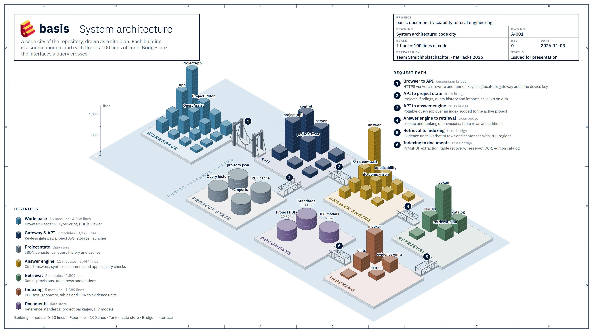
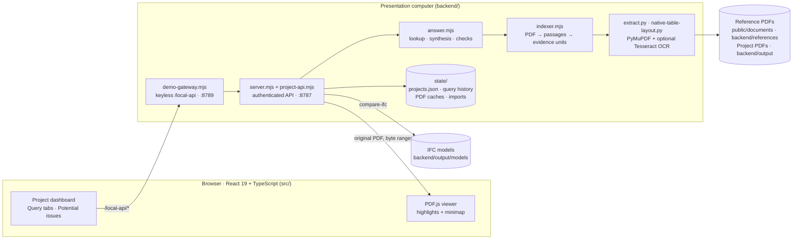

# *basis*

**Where did this number come from?** Civil engineers often need a drawing, a client brief and a design standard to check a single value. basis brings those documents into one project workspace. Ask a question about the project, then select a citation to see the passage or table row highlighted in the original PDF.

[Open basis](https://streichholzschachtel.vercel.app/#projects)

Built for natHacks 2026 by team Streichholzschachtel.

---

## Contents

- [What *basis* does](#what-basis-does)
- [Try a design review](#try-a-design-review)
- [How it works](#how-it-works)
  - [System overview](#system-overview)
  - [Deployment topology](#deployment-topology)
  - [Indexing pipeline](#indexing-pipeline)
  - [Query pipeline](#query-pipeline)
  - [Project isolation](#project-isolation)
  - [IFC model comparison](#ifc-model-comparison)
- [Demonstration projects](#demonstration-projects)
- [Run locally](#run-locally)
- [Configuration](#configuration)
- [API at a glance](#api-at-a-glance)
- [Testing and verification](#testing-and-verification)
- [Repository map](#repository-map)
- [Design system](#design-system)
- [Limitations and honesty rules](#limitations-and-honesty-rules)
- [Roadmap and open issues](#roadmap-and-open-issues)
- [Further reading](#further-reading)

---

## What *basis* does

Civil engineering decisions rest on a stack of documents: a client brief, drawings, technical reports and municipal or provincial standards. When a number looks wrong, such as a pipe grade, a lane width or a traffic count, the reviewer has to find where it came from and which rule governs it. *basis* shortens that search.

| Capability | What the engineer sees |
| --- | --- |
| **Project workspaces** | Each project groups its own drawings, reports and client documents with selected reference collections (for example *Edmonton urban servicing* or *Alberta highway design*). |
| **Cited answers** | Every sentence in an answer cites a verbatim table row or sentence. Selecting the citation opens the original PDF on the right page with the passage highlighted. |
| **Potential issues** | Prepared cross-document findings (for example "drawing slope below the standard's minimum") with evidence from both sides, which the engineer can inspect and dismiss. |
| **IFC comparison** | A bounded checker compares numeric statements in project documents against properties in the project's IFC building/infrastructure model. |
| **Version awareness** | Reference PDFs are identified by SHA-256 hash, so answers can state which edition of a standard they cite and whether a newer one exists in the collection. |
| **Offline by default** | The default engine is deterministic and extractive. It needs no API key, no model download and no hosted inference. |
| **Conversational help** | When a query has no answer, *basis* offers clarifying questions, nearby alternatives that have already been checked to return sourced answers, or a note about which document is missing. |

---

## Try a design review

1. **Ask a live question.** Open **Parkview Exchange Redevelopment -> New query**, enter “How long is sanitary pipe S1?” and select **Search**. Click the citation beside the answer to verify the **43 m** length in the project’s model register.
2. **Check a finding across three documents.** Open **North Ridge Highway Intersection Upgrade**. Under **Potential issues**, expand **Crest sight distance is below the screening value** and select **Inspect evidence**. In the first paragraph, click citation **2** for the drawing’s **165 m** sight distance, **1** for the provincial guide’s **185 m** level-road value at 100 km/h, and **3** for the owner’s adoption of that value. The **20 m** difference gives the engineer a reason to check the survey and road grade.

The built-in projects pair synthetic design records with published standards. The North Ridge review is prepared and can be reopened immediately. New queries run on the backend workstation and search only the active project’s files. The hosted app requires that workstation and its HTTPS tunnel to be online.

More questions to try in **New query**:

| Project | Question |
| --- | --- |
| Parkview | `What is the nominal pipe diameter of IFC object S1?` |
| Parkview | `What is the vertical clearance at IFC crossing X1?` |
| Parkview | `What is the minimum slope for an upstream sanitary sewer?` |
| North Ridge | `What is the thickness of IFC object PAV-ACP?` |
| North Ridge | `What is the design speed of IFC object RD-EB?` |

---

## How it works



*Each island is a layer of the system and each building is a source module, one floor per 100 lines of code. Bridges ① to ⑥ trace a query from the browser to the documents, with ② branching off to where the server saves project state. To regenerate the figure, run `node docs/architecture/build-code-city.mjs --png`.*

For presentations, open [docs/architecture/code-city-3d.html](docs/architecture/code-city-3d.html) in Chrome or Edge and press **F** for full screen. This animated 3D version opens on a blueprint site plan seen from above, tilts down until the plan lies flat and raises the blue ground, islands and buildings out of it in 6 seconds. Then each press of **Space** or **→** (or a presentation clicker) drops the next island, with a short phrase saying what it does and the numbered bridge carrying what it sends on; **←** takes the last island back off. Add `?auto=1` to the address to have the islands drop by themselves, timed to a 35-second spoken walkthrough (the script is in the page's code comments). Once Project state is shown, clicking its pin or the island opens the live product. Once every island is shown, **→** steps into the islands one by one; or add `?tour=1` to the address to play the full 30-second island tour. Every building is numbered; a number that would collide with another label moves aside and keeps a leader line to its building. The card in the corner lists every module of the island by number, with its name, what it does and its line count. A levelling staff beside each island gives the height scale in lines of code. The callout for the bridge leading into the island explains that interface. In the tour, each stop is timed to one sentence of a spoken walkthrough (the script is in the comments at the top of the page's code), and `?tour=1&pace=1.2` makes every stop 20% longer. Press **O** to return to the overview, which replays the opening. The page works offline.

### System overview



### Deployment topology

The public site is a static Vite build on Vercel. Vercel rewrites `/local-api/*` through a Cloudflare HTTPS tunnel to the gateway on the host computer, where all document processing happens. The gateway adds the device key internally, so the key never leaves that computer.

| Port | Service | Notes |
| --- | --- | --- |
| 8787 | Demo API | Requires the device key (`state/session-token.txt`). |
| 8789 | Gateway | Keyless `/local-api` for the local UI and Vercel rewrites. Serves the built UI at `/app/`. |
| 8788 | Development API | Used for engine experiments, kept separate from the demo. |
| 8840 / 8842 | Isolated test runtime | The only safe target for destructive reset tests. |

Because the public site depends on the host computer and the tunnel being online, a recreated tunnel needs the rewrite in [vercel.json](vercel.json) updated (launcher control **P** does this).

### Indexing pipeline

1. **Identify the edition.** `catalog.mjs` looks up the PDF's SHA-256 hash to attach its publisher, edition and date. An unknown PDF is still indexed, labelled "edition not supplied".
2. **Extract.** `extract.py` (PyMuPDF) reads the words and their page geometry, using Tesseract OCR for scanned pages. `native-table-layout.py` recovers the columns of ruled tables. Results are cached with atomic writes.
3. **Build evidence units.** `indexer.mjs` normalises measurements and annotates sections. `units.mjs` groups lines into cells, table rows and sentences, each keeping its exact PDF regions.
4. **Search.** The units feed `SearchIndex` (`search.mjs`) and `UnitIndex` (`lookup.mjs`).

If Python and PyMuPDF are unavailable, a pdf.js fallback extractor is used with its own cache, so installing the native extractor later triggers a clean rebuild.

### Query pipeline

A query is a pollable job. Each citation in the result carries a document ID, a page number and highlight rectangles.

1. The browser posts the question to `/local-api/v1/projects/:id/queries`. The gateway forwards it with the device key.
2. `project-api.mjs` builds an index from **this project's documents only** and returns a job ID.
3. `answer.mjs` runs `lookup.mjs`, which applies domain rewrites (for example "manhole" → "maintenance hole") and ranks provisions and table rows. Version questions are answered from the catalog's cover and revision pages.
4. If evidence is found, it is rendered as verbatim units with their PDF regions. If not, `clarify.mjs` and `query-suggestions.mjs` offer clarifying questions or alternatives that have already been checked to return sourced answers.
5. If a synthesis provider is configured, it drafts cited sentences. Each sentence must pass the checks (valid citation IDs, every number present in the cited text, applicability and calculation checks, optional contradiction veto). If no sentence passes, *basis* falls back to the verbatim answer.
6. The browser polls until the result is ready, then requests the original PDF with byte ranges and highlights the passage.

### Project isolation

- Omitting `documentIds` selects the project's associated documents; an explicit `[]` selects nothing; foreign IDs are rejected.
- The index built for a query physically contains only that project's documents, passages and layout units. Returned citation IDs are checked again before they leave the API.
- Cache identity includes the project, document and engine revisions, so changing scope never serves a stale answer.
- This is logical isolation for a single-device prototype, not multi-tenant authentication.

### IFC model comparison

**Compare IFC** in *Potential issues* scans selected project documents for statements that name an IFC element or tag with a numeric property and unit (for example `IND-LOCAL-02 maximum design speed: 40 km/h`), then compares them to the property values in the project's IFC model (`ifc-comparison.mjs`). Findings include the IFC value, STEP ID, GlobalId, source page and excerpt. Dismissals survive rescans. It's a bounded property checker, not a compliance certificate. See the [backend guide](backend/README.md#ifc-document-comparison).

---

## Demonstration projects

Four protected projects are restored on startup and by **Reset demo**. All owners, consultants, site data and calculations are fictional and marked *issued for review / not for construction*; the referenced standards are untouched official publications.

| Project | ID | Domain | Contents |
| --- | --- | --- | --- |
| **Parkview Exchange Redevelopment** | `parkview-exchange` (PX-26017) | Urban servicing, Edmonton | 6 project PDFs, IFC model + register, 4 prepared findings, 7 query fixtures |
| **North Ridge Highway Intersection Upgrade** | `north-ridge-highway` (NRH-26104) | Highway geometry and pavement, Alberta | 6 project PDFs, IFC model + register, 4 prepared findings, 7 query fixtures |
| **Mill Creek Corner Infill** | `demo-mill-creek` | Drainage / low-impact development | Client brief, concept design, site note |
| **Willow Creek Bridge Renewal** | `demo-willow-creek` | Bridge and drainage | Client brief, concept design, drainage note |

Documents in each project are grouped into five categories: **Reference**, **Client requirements**, **Design**, **Technical reports** and **Supporting materials**.

Prepared findings (details and reasoning in [PROJECT-PACKAGES.md](backend/demo/PROJECT-PACKAGES.md)):

- **Parkview:** S1 sanitary grade 0.30% is below the upstream minimum · ST1 storm cover of 1.650 m has no insulation detail · clearance where the X1 sewer service passes below the watermain.
- **North Ridge:** lane marking widths against Chapter C · available sight distance of 165 m against 185 m level-road SSD · TIA missing the 20-year horizon · traffic and truck-share mismatch between reports.

Regenerating the fictional packages needs Python with ReportLab (`backend/demo/build-project-packages.py`) and, for the IFC models, the packages in `backend/requirements-models.txt` (`build-ifc-models.py`, `build-model-registers.py`). Every file's SHA-256 is recorded in `backend/demo/package-provenance.json`.

---

## Run locally

### Requirements

| Requirement | Needed for |
| --- | --- |
| **Node.js 24+** | Everything (the launcher checks this) |
| Python 3.10+ and `backend/requirements.txt` (PyMuPDF) | Native PDF and table extraction (recommended) |
| Tesseract with English data | Searching scanned PDF pages |

### Install

From the repository root:

```powershell
npm ci
npm ci --prefix backend
```

Optional native extraction (from `backend/`):

```powershell
python -m venv .venv
.venv\Scripts\python.exe -m pip install -r requirements.txt
```

On macOS or Linux use `.venv/bin/python`. Linux helper scripts live in [scripts/linux/](scripts/linux/) (`install`, `install-ocr`, `install-gpu`, `install-tunnel`, `basis`).

### Start

Double-click **Start basis.cmd** and choose **5** to open the workspace at `http://127.0.0.1:8789/app/#home`.

| Key | Action |
| --- | --- |
| 1 | Start (keeps a healthy running API) |
| 2 | Rebuild changed frontend, restart API, index new PDFs |
| 3 | Stop API and gateway |
| 4 | Status: indexing, failures, gateway, profile |
| 5 | Open the local interface |
| 6 | Diagnostics: disk, extractor, OCR, cache, Vercel connection |
| 7 | Open logs |
| 8 | Rebuild frontend only |
| D | Repair dependencies from lockfiles |
| T | Read-only check of both demos, all PDFs and citations |
| H / P | Start HTTPS tunnel / publish its address to Vercel |

The same actions are available from `backend/` as `node control.mjs --status`, `--start`, `--restart`, `--reindex`, `--stop`, `--build`, `--check-demo`, `--diagnose`, `--https`, `--publish`. While the window is open, a watchdog restarts a failed API or gateway (max three recoveries in ten minutes). Full details: [CONTROLS.md](backend/CONTROLS.md).

### Frontend development

Start the gateway with the launcher, then run `npm run dev` in the repository root. Set `BASIS_DEV_BACKEND_URL` if the gateway isn't on 8789.

| Root script | Purpose |
| --- | --- |
| `npm run dev` | Vite dev server |
| `npm run build` | Type-check and build to `dist/` |
| `npm run lint` | oxlint |
| `npm run format` / `format:check` | Prettier |
| `npm run test:ui` | Workspace, history and examples verification scripts |

| Backend script (`backend/`) | Purpose |
| --- | --- |
| `npm start` | Run the API directly |
| `npm run launch` | Run the controller |
| `npm run index` | Build the index from the CLI |
| `npm test` | Unit tests |
| `npm run demo` / `demo:api` | Run demo questions in-process / through the job API |

---

## Configuration

Copy `backend/.env.example` to `backend/.env`. No key is required for the default setup.

| Variable | Default | Purpose |
| --- | --- | --- |
| `PORT` | `8787` | API port |
| `EXTRACTIVE_ONLY` | `1` | Retrieval and excerpts without generation |
| `LOCAL_SYNTHESIS` | `0` | Enable the local consolidated-answer path |
| `ENTAILMENT_MODEL_DIR` / `ENTAILMENT_PYTHON` | — | Optional contradiction veto |
| `PDF_CACHE_DIR` | `state/` | Extraction cache location |
| `TESSERACT_PATH` | auto-detected | OCR binary |
| `BASIS_STATE_DIR` | `backend/state` | Isolate development or test storage |
| `FRONTEND_URL` / `ALLOWED_ORIGINS` | Vercel URL / empty | CORS |

---

## API at a glance

The frontend uses the keyless `/local-api` gateway; the API underneath requires the device key. Full contract: [PROJECT_API.md](backend/PROJECT_API.md).

| Method | Route | Purpose |
| --- | --- | --- |
| GET | `/v1/reference-collections` | Collections, jurisdictions, document metadata |
| GET / POST | `/v1/projects` | List / create projects |
| GET / PATCH / DELETE | `/v1/projects/:project` | Read / edit / delete (protected demos return 403 on delete) |
| POST | `/v1/projects/:project/documents/import` | Import a base64 PDF (≤ 12 MB, indexed before 201) |
| GET / POST | `/v1/projects/:project/queries` | History / submit a pollable query job |
| GET / PATCH / DELETE | `/v1/projects/:project/queries/:query` | Read / bookmark / cancel |
| PATCH | `/v1/projects/:project/issues/:issue` | Dismiss or reopen a finding |
| POST | `/v1/projects/:project/compare-ifc` | Rescan IFC comparison |
| GET | `/v1/projects/:project/documents/:document/file` | Original PDF with byte ranges |
| GET | `/v1/projects/:project/documents/:register/model` | Download the associated IFC |
| POST | `/v1/demo/reset` | Restore protected demos, drop unprotected projects |

Frontend routes are hash-based: `#projects`, `#project/ID`, `#project/ID/new`, `#project/ID/query/QUERY`, `#project/ID/document/DOCUMENT`.

Persistence is JSON on disk: `state/projects.json` (atomic replace with a backup), `state/project-queries/PROJECT/QUERY.json` for history, and `state/project-documents/PROJECT/` for imported private PDFs. Run one API per state directory.

---

## Testing and verification

`backend/tests/` holds about 50 suites, named by type:

| Suffix | Kind | Example |
| --- | --- | --- |
| `*.test.mjs` | Unit (`npm test`) | `retrieval`, `applicability`, `calculations`, `ifc-comparison` |
| `*.integration.mjs` | Against a running API | `projects`, `imports`, `ifc`, `https`, `control` |
| `*.browser.mjs` | Playwright UI checks | `projects`, `ifc`, `query-suggestions`, `workspace-controls` |
| `*.py` | Python checks | `ifc-models.py`, `entailment-benchmark.py`, `ocr-output.test.py` |
| other | Suites and benchmarks | `quality.mjs`, `presentation.smoke.mjs`, `local-model-benchmark.mjs` |

```powershell
cd backend
node --test --test-concurrency=1 tests/*.test.mjs
npm run demo:api
```

Destructive reset tests must run against the isolated 8840/8842 runtime with `BASIS_STATE_DIR` pointing at `state/ui-preview`, never the presenter's live state.

---

## Repository map

```text
Streichholzschachtel/
├── Start basis.cmd              # One-click launcher → backend/control.mjs
├── index.html · vite.config.ts · vercel.json
├── src/                         # Frontend (React 19, TypeScript, Vite, PDF.js)
│   ├── main.tsx                 # Entry → ProjectApp
│   ├── ProjectApp.tsx           # Projects overview, dashboard, query reader, routing
│   ├── App.tsx                  # Query workspace (report + PDF side by side)
│   ├── ProjectEditor.tsx        # Create/edit projects, import PDFs, pick collections
│   ├── QueryTabs.tsx · useQueryTabs.ts   # Renamable query tabs
│   ├── QueryReport.tsx · QueryAssist.tsx · QuerySuggestions.tsx
│   ├── PdfPane.tsx · DocumentMinimap.tsx · pdf.ts   # Viewer and highlights
│   ├── backend.ts · projects.ts · data.ts           # API client and contracts
│   └── WorkspaceSettings.tsx · AppHeader.tsx · navigation.ts
├── public/
│   └── documents/               # 30 City of Edmonton / EPCOR reference PDFs
├── backend/
│   ├── control.mjs              # Launcher, watchdog, build, tunnel, publish
│   ├── demo-gateway.mjs         # Keyless /local-api gateway
│   ├── extract.py · native-table-layout.py   # PyMuPDF extraction + OCR
│   ├── src/
│   │   ├── server.mjs · project-api.mjs · project-store.mjs   # HTTP + persistence
│   │   ├── indexer.mjs · units.mjs · catalog.mjs              # Indexing + editions
│   │   ├── search.mjs · lookup.mjs · retrieval-plan.mjs       # Retrieval
│   │   ├── answer.mjs · local-synthesis.mjs · model.mjs   # Answering
│   │   ├── applicability.mjs · calculations.mjs · entailment.mjs       # Checks
│   │   ├── clarify.mjs · query-suggestions.mjs                # Conversational help
│   │   └── ifc-comparison.mjs · project-evidence.mjs          # Findings
│   ├── demo/                    # Fictional project packages, manifests, generators
│   ├── references/              # Alberta highway guides and bulletins
│   ├── output/pdf · output/models   # Generated project PDFs and IFC models
│   ├── IFC/                     # Source IFC files for the four demo projects
│   ├── tests/                   # Unit, integration, browser and benchmark suites
│   └── state/                   # (ignored) projects, history, caches, logs
├── scripts/                     # UI verification + Linux install/run helpers
└── docs/architecture/           # Code-city architecture figure and 3D presentation
```

---

## Design system

| Token | Colour | Use |
| --- | --- | --- |
| Background | `#F4FFFD` | Page |
| Text | `#011936` | Body text |
| Secondary | `#465362` | Supporting text |
| Accent | `#F9DC5C` | Highlights |
| Issues | `#ED254E` | Reserved for potential-issue states |

Fonts: IBM Plex Sans for body text, Roboto Mono Bold for the logo, buttons and project headings, and IBM Plex Mono for code and values. Icons come from lucide-react.

---

## Limitations and honesty rules

*basis* is built so that it can't invent an engineering answer:

- **Every displayed excerpt is original text** with its real PDF regions. Models cite unit IDs; they never retype quotes.
- **Numbers are checked.** A generated sentence is withheld if any number in it doesn't appear in the cited text, the question or the catalog.
- **Conditional duties stay conditional.** "If an underdrain is present…" isn't turned into "install an underdrain".
- **Unsupported questions say so**, with no document citations.
- **"No findings" isn't compliance.** The IFC checker and prepared findings are bounded review aids.

Known limits: this is a single-device prototype with JSON persistence; the public demo depends on the host computer and tunnel staying online; IFC models are shown as registers, not an interactive 3D view; general IFC upload isn't implemented; local synthesis quality is still being evaluated.

---

## Roadmap and open issues

- [ ] Fuzzy/semantic term matching when exact search finds nothing (for example "thermal movement" → "thermal expansion").
- [ ] Fix recall gaps (for example "erosion" not returning every passage containing it).
- [ ] Team features: managers viewing projects and queries across engineers, collaboration and shared citations with architects and trades, possibly as an extension to existing platforms.

---

## Further reading

| Document | Topic |
| --- | --- |
| [backend/README.md](backend/README.md) | Backend setup, data layout, IFC comparison |
| [backend/PROJECT_API.md](backend/PROJECT_API.md) | API contract, isolation, persistence |
| [backend/CONTROLS.md](backend/CONTROLS.md) | Launcher controls and recovery |
| [backend/demo/PROJECT-PACKAGES.md](backend/demo/PROJECT-PACKAGES.md) | Demo provenance and engineering review decisions |
| [backend/demo/IFC-MODELS.md](backend/demo/IFC-MODELS.md) | IFC models and registers |
